# Báo cáo Phân Tích An Toàn Thông Tin & Ma Trận Kịch Bản Tấn Công

## 1. Tóm Tắt 12 Điểm Yếu Bảo Mật Trong Ứng Dụng Gốc (Vulnerability Summary)

Quá trình dịch ngược và phân tích tĩnh cho thấy SHAREit 6.53.38_UD mắc nhiều lỗ hổng bảo mật nghiêm trọng do kiến trúc thừa kế từ phiên bản cũ và áp lực tích hợp quá nhiều mạng quảng cáo:

| # | Điểm yếu bảo mật phát hiện | Mức độ nguy cơ | Ảnh hưởng thực tế |
|---|---|---|---|
| **1** | **Toàn bộ kết nối cho phép Cleartext HTTP** (`usesCleartextTraffic="true"`) | **NGHIÊM TRỌNG** | Bị tấn công nghe lén (Sniffing), sửa đổi dữ liệu (MITM) |
| **2** | **Khai báo 202 Permissions quá mức cần thiết** | **NGHIÊM TRỌNG** | Thu thập quyền nhạy cảm (SMS, Gọi điện, Danh bạ, Quét toàn bộ App) |
| **3** | **86 Android Components bị Export tùy tiện** (`exported="true"`) | **NGHIÊM TRỌNG** | Ứng dụng độc hại khác có thể gọi trái phép Intent / Provider |
| **4** | **Thu thập trái phép định danh phần cứng (IMEI, IMSI, MAC)** | **NGHIÊM TRỌNG** | Vi phạm chính sách bảo mật của Google Play / Apple Store |
| **5** | **Bỏ qua lỗi SSL trong các WebView quảng cáo** (`onReceivedSslError`) | **CAO** | Kẻ tấn công có thể chèn mã độc vào WebView qua mạng công cộng |
| **6** | **Nguy cơ RCE qua JavaScript Bridge** (`addJavascriptInterface` 19 vị trí) | **CAO** | Thực thi mã tùy ý nếu mở trang web độc hại |
| **7** | **Khóa API Google Maps & AdMob nhúng cứng trong mã** | **TRUNG BÌNH** | Bị kẻ xấu trích xuất khóa và lạm dụng hạn ngạch / chi phí |
| **8** | **Lộ lọt Endpoint thử nghiệm dev/test và loopback `10.0.2.2`** | **TRUNG BÌNH** | Tiết lộ kiến trúc nội bộ của máy chủ phát triển |
| **9** | **Cơ chế mã hóa yếu (AES/ECB, MD5 không có Salt)** | **TRUNG BÌNH** | Dữ liệu mã hóa dễ bị giải mã theo phương pháp tấn công khối |
| **10** | **Két an toàn Safebox lưu trữ không mã hóa Zero-Knowledge** | **CAO** | Nếu máy bị root hoặc chiếm quyền, file trong két bị đọc trực tiếp |
| **11** | **Nguy cơ kết nối trạm phát Wi-Fi giả mạo (Rogue Hotspot)** | **CAO** | Bị đánh cắp file truyền khi kết nối vào Hotspot mạo danh |
| **12** | **Lạm dụng quyền Overlay `SYSTEM_ALERT_WINDOW`** | **TRUNG BÌNH** | Hiển thị quảng cáo đè lên các ứng dụng khác gây khó chịu |

---

## 2. Ma Trận 10 Kịch Bản Tấn Công Chi Tiết & Phương Pháp Phòng Chống

```mermaid
flowchart LR
    Attacker((Kẻ Tấn Công))
    subgraph AttackVectors [Vectơ Tấn Công]
        V1[1. MITM HTTP Sniffing]
        V2[2. Intent Injection]
        V3[3. WebView JS RCE]
        V4[4. Rogue Hotspot P2P]
        V5[5. Replay API Attack]
    end

    subgraph DefenseLayer [Lớp Phòng Thủ Đã Nâng Cấp]
        D1[TLS 1.3 & Certificate Pinning]
        D2[Exported=False & Permission Validation]
        D3[Domain Whitelist & Secure Bridge]
        D4[ECDH Session Handshake & AES-GCM]
        D5[HMAC-SHA256 + Sliding Window Nonce]
    end

    Attacker --> AttackVectors
    AttackVectors --> DefenseLayer
```

---

### Kịch bản 1: Tấn Công Nghe Lén & Chèn Mã Độc Qua Mạng (Man-in-the-Middle - MITM)
* **Phương pháp tấn công**: Kẻ tấn công cùng mạng Wi-Fi công cộng thực hiện kỹ thuật ARP Spoofing hoặc DNS Spoofing. Do ứng dụng bật `usesCleartextTraffic=true` và nhiều API chạy trên cổng HTTP (như `http://api2.wshareit.com/ping/`, `http://ladon.dalyfeds.com`), kẻ tấn công bắt trọn gói tin, đọc nội dung file đang truyền qua relay và chèn quảng cáo giả mạo chứa link tải mã độc.
* **Hậu quả**: Lộ lọt dữ liệu cá nhân, người dùng bị cài phần mềm độc hại.
* **Giải pháp phòng chống trong bản mới**:
  1. Đặt `android:usesCleartextTraffic="false"` trong `AndroidManifest.xml`.
  2. Bắt buộc 100% kết nối qua **HTTPS / TLS 1.3**.
  3. Cấu hình **Certificate Pinning** trong `NetworkSecurityConfig` và OkHttp Client.

---

### Kịch bản 2: Tấn Công Kích Hoạt Trái Phép Thành Phần (Intent & Component Injection)
* **Phương pháp tấn công**: APK cũ có 58 Activity và 7 Service đặt `exported="true"` không có quyền bảo vệ (như `SafeBoxVerifyActivity`, `HybridLocalActivity`, `AppBrowser`). Một ứng dụng độc hại cài trên cùng thiết bị có thể gửi một Explicit Intent để vượt qua màn hình xác thực mã PIN của Safebox hoặc ép `AppBrowser` mở đường dẫn URL độc hại `file:///data/data/com.nextai.sharenow/databases/...`.
* **Hậu quả**: Kẻ xấu vượt mặt khóa két sắt, đọc trộm cơ sở dữ liệu nội bộ và file riêng tư.
* **Giải pháp phòng chống trong bản mới**:
  1. Đặt mặc định `android:exported="false"` cho toàn bộ Activity, Service, Receiver nội bộ.
  2. Chỉ export các Activity có Intent-Filter chính đáng (Launcher, Share Sheet) và kiểm tra nghiêm ngặt `intent.data` và `callingPackage`.
  3. Xác thực mã PIN ở tầng ViewModel và giải mã trong bộ nhớ RAM tạm thời, không dựa vào trạng thái mở Activity.

---

### Kịch bản 3: Thực Thi Mã Từ Xa Qua JavaScript Bridge (WebView RCE)
* **Phương pháp tấn công**: App đăng ký 19 hàm `addJavascriptInterface` vào WebView nhưng không giới hạn nguồn URL tải vào. Khi người dùng kết nối mạng hoặc nhận đường link quảng cáo chứa mã JavaScript độc hại, trang web sẽ gọi ngược vào đối tượng Java Bridge để đọc file thẻ nhớ, đánh cắp danh bạ hoặc tải file APK về máy.
* **Hậu quả**: Chiếm quyền điều khiển thiết bị từ xa qua giao diện Web.
* **Giải pháp phòng chống trong bản mới**:
  1. Chỉ bật `addJavascriptInterface` trên các trang thuộc Whitelist nội bộ có chữ ký số.
  2. Luôn kiểm tra `url.startsWith("https://your-domain.com")` trong `shouldOverrideUrlLoading` trước khi inject bridge.
  3. Tắt `setAllowFileAccessFromFileURLs(false)` và `setAllowUniversalAccessFromFileURLs(false)`.

---

### Kịch bản 4: Tấn Công Trạm Phát Wi-Fi Giả Mạo Trong Chia Sẻ P2P (Fake Hotspot Attack)
* **Phương pháp tấn công**: Trong cơ chế chia sẻ không dây cũ, máy gửi tạo một trạm phát Wi-Fi Hotspot với mật khẩu cố định hoặc quy luật SSID dễ đoán (ví dụ: `DIRECT-xx-SHAREit`). Kẻ tấn công tạo một Hotspot giả mạo có cùng tên SSID và cường độ sóng mạnh hơn để lừa máy nhận kết nối vào, sau đó phân tích lưu lượng truyền tải.
* **Hậu quả**: Kẻ tấn công thu thập toàn bộ file đang được chuyển giao giữa hai thiết bị.
* **Giải pháp phòng chống trong bản mới**:
  1. Tạo SSID và Mật khẩu WPA2/WPA3 ngẫu nhiên với độ entropy cao (sinh ngẫu nhiên 16 ký tự).
  2. Truyền mã khóa phiên Handshake thông qua **Mã QR trực quan** hoặc mã PIN 6 số dùng một lần (One-Time-Pad).
  3. Thiết lập kênh trao đổi khóa **ECDH (Elliptic Curve Diffie-Hellman)** giữa 2 máy trước khi truyền dữ liệu, mã hóa toàn bộ luồng TCP bằng **AES-256-GCM**.

---

### Kịch bản 5: Tấn Công Phát Lại & Giả Mạo Yêu Cầu API (Replay & Tampering Attack)
* **Phương pháp tấn công**: Kẻ tấn công bắt một request hợp lệ (như request điểm danh nhận Coin `/api/v1/coin/checkin` hoặc tạo đơn hàng VIP `/api/v1/pay/order/create`), sau đó dùng công cụ tự động gửi lặp lại hàng nghìn lần để farm điểm hoặc tấn công làm tê liệt dịch vụ.
* **Hậu quả**: Lạm phát hệ thống điểm thưởng, sai lệch dữ liệu tài chính.
* **Giải pháp phòng chống trong bản mới**:
  1. Áp dụng cơ chế **Request Signing (HMAC-SHA256)**: Chữ ký bao gồm `Method + Path + Timestamp + Nonce + Body`.
  2. Máy chủ kiểm tra cửa sổ thời gian hiệu lực `Timestamp` (trong vòng ±30 giây) và lưu `Nonce` vào Redis trong 60 giây để loại bỏ mọi request trùng lặp (Idempotent API).

---

### Kịch bản 6: Đánh Cắp Khóa API Nhúng Trong Mã Ứng Dụng (API Key Harvesting)
* **Phương pháp tấn công**: Dùng công cụ `jadx` hoặc `apktool` để dịch ngược file `.apk` và tìm kiếm chuỗi ký tự dạng `AIzaSy...` để lấy cắp khóa Google Maps, Firebase hoặc AdMob App ID. Kẻ tấn công dùng khóa này trong ứng dụng riêng của họ, làm tiêu tốn hạn ngạch (Quota) và phát sinh chi phí của bạn.
* **Giải pháp phòng chống trong bản mới**:
  1. Cấu hình **Application Restrictions** trên Google Cloud Console: Chỉ cho phép gọi API từ Android Package Name và SHA-1 Fingerprint của chứng chỉ ký chính thức.
  2. Toàn bộ các API nghiệp vụ quan trọng hoặc có tính phí phải đi qua **Backend Proxy** trên cổng 6030, không lưu API Secret Key ở tầng Client.

---

### Kịch bản 7: Tấn Công Khai Thác Két Khóa Safebox (Vault Brute-Force & Memory Dump)
* **Phương pháp tấn công**: Trong các phiên bản cũ, file khóa trong Safebox chỉ được ẩn bằng cách đổi đuôi mở rộng hoặc mã hóa với khóa cố định trong code. Khi thiết bị bị Root, kẻ tấn công có thể vào thư mục nội bộ và đọc trực tiếp file.
* **Giải pháp phòng chống trong bản mới**:
  1. Áp dụng chuẩn **Zero-Knowledge Encryption**: Mỗi file trong Safebox được mã hóa bằng **AES-256-GCM**. Khóa mã hóa được phái sinh từ Mật khẩu của người dùng kết hợp hàm băm **PBKDF2WithHmacSHA256** (100.000 vòng lặp) cùng Salt ngẫu nhiên.
  2. Mật khẩu không bao giờ được lưu xuống đĩa; nếu người dùng quên mật khẩu, dữ liệu không thể phục hồi (Zero-Knowledge).

---

### Kịch bản 8: Đánh Cắp Dữ Liệu Riêng Tư & Theo Dõi Trái Phép (Privacy Fingerprinting Breach)
* **Phương pháp tấn công**: Ứng dụng gốc đọc IMEI, IMSI, địa chỉ MAC và quét toàn bộ danh sách Ứng dụng cài đặt trên máy (`QUERY_ALL_PACKAGES`) rồi đẩy về máy chủ quảng cáo bên thứ ba, khiến người dùng bị theo dõi hành vi và vi phạm nghiêm trọng chuẩn GDPR / Google Play Policy.
* **Giải pháp phòng chống trong bản mới**:
  1. Loại bỏ 100% các lệnh gọi API phần cứng cũ (`getDeviceId()`, `getMacAddress()`).
  2. Chỉ sử dụng **AppSetID** hoặc **GAID (Google Advertising ID)** có sự đồng ý của người dùng.
  3. Tuân thủ tuyệt đối chuẩn GDPR và cung cấp tùy chọn Xóa hoàn toàn dữ liệu tài khoản (`DELETE /api/v1/auth/user/destroy`).

---

### Kịch bản 9: Tấn Công Độc Hại Qua Cơ Chế Cập Nhật Tự Động (Malicious APK Update Attack)
* **Phương pháp tấn công**: Kẻ tấn công giả mạo endpoint kiểm tra cập nhật `/upgrade/check` qua mạng HTTP không an toàn để trả về đường dẫn tải file APK chứa mã độc (Trojan/Spyware) và ép người dùng cài đặt.
* **Giải pháp phòng chống trong bản mới**:
  1. Toàn bộ payload trả về từ máy chủ cập nhật phải chứa chuỗi băm **SHA-256** của file APK mới.
  2. Client tự động tính toán mã băm của file tải về và chỉ cho phép cài đặt nếu mã băm khớp 100% với dữ liệu từ máy chủ đã ký số.

---

### Kịch bản 10: Tấn Công Độc Chiếm Quyền Hiển Thị (Overlay Clickjacking Attack)
* **Phương pháp tấn công**: Lạm dụng quyền `SYSTEM_ALERT_WINDOW` để hiển thị các màn hình quảng cáo trong suốt đè lên ứng dụng ngân hàng hoặc ví điện tử nhằm đánh lừa người dùng bấm xác nhận giao dịch chuyển tiền ngoài ý muốn.
* **Giải pháp phòng chống trong bản mới**:
  1. Không xin quyền `SYSTEM_ALERT_WINDOW` nếu không có tính năng Picture-in-Picture (PiP) hoặc Floating Player thực sự cần thiết.
  2. Bật cờ `android:filterTouchesWhenObscured="true"` trên tất cả các màn hình giao dịch quan trọng và Paywall để ngăn chặn hoàn toàn việc chạm qua lớp phủ (Tapjacking Prevention).

