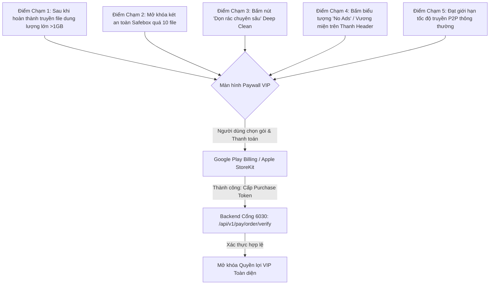
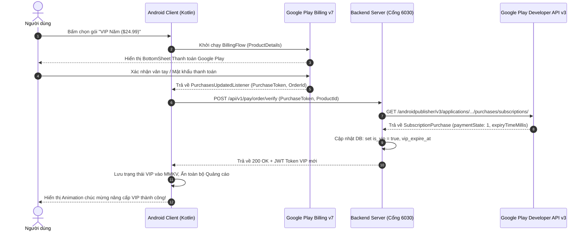

# Báo cáo Phân Tích Kịch Bản Paywall, Gói Cước Subscription & Bản Đồ Mua Hàng (Map Purchase)

## 1. Phân Tích Kịch Bản Kích Hoạt Paywall (Paywall Triggers & User Flow)

Ứng dụng SHAREit triển khai chiến lược kiếm tiền kép (Hybrid Monetization): vừa chạy quảng cáo (Ads), vừa thúc đẩy chuyển đổi người dùng sang thuê bao VIP (Subscription). Paywall được thiết kế hiển thị tại các điểm chạm có giá trị cao (High-Intent Touchpoints):

---

## 2. Ma Trận Các Gói Thuê Bao VIP & Đặc Quyền (Pricing & Entitlements)

| Mã Gói (Plan ID) | Tên Gói Cước | Thời hạn | Mức giá Đề xuất | Google Product ID | Apple Product ID | Đặc quyền mở khóa (Privileges) |
|---|---|---|---|---|---|---|
| `vip_weekly` | Gói VIP Tuần | 7 ngày (Có 3 ngày dùng thử) | $1.99 / tuần | `shareit.vip.weekly` | `com.shareit.sub.weekly` | • Không quảng cáo 100% • Tốc độ truyền tối đa (Max Speed 200MB/s) • Két Safebox dung lượng 50GB |
| `vip_monthly` | Gói VIP Tháng | 30 ngày | $4.99 / tháng | `shareit.vip.monthly` | `com.shareit.sub.monthly` | • Toàn bộ quyền gói tuần • Tải video HD không giới hạn • Quét dọn rác chuyên sâu tự động |
| `vip_yearly` | **Gói VIP Năm (Phổ biến nhất - Tiết kiệm 50%)** | 365 ngày | $24.99 / năm ($2.08/th) | `shareit.vip.yearly` | `com.shareit.sub.yearly` | • Toàn bộ quyền gói tháng • Cloud Vault 200GB • Huy hiệu VIP độc quyền trên hồ sơ • Hỗ trợ kỹ thuật ưu tiên 24/7 |
| `vip_lifetime` | Gói VIP Trọn Đời (Mua 1 lần) | Vĩnh viễn (Non-consuming) | $49.99 (Thanh toán 1 lần) | `shareit.vip.lifetime` | `com.shareit.sub.lifetime` | • Mở khóa vĩnh viễn toàn bộ tính năng cao cấp cho mọi thiết bị đăng nhập cùng tài khoản |

---

## 3. Bản Đồ Quy Trình Mua Hàng Chi Tiết (Map Purchase Lifecycle)

---

## 4. Xử Lý Các Trường Hợp Biên & Sự Kiện Tự Động (Edge Cases & Lifecycle)

1. **Khôi Phục Gói Đã Mua (Restore Purchases)**:
   - Khi người dùng cài lại máy hoặc đổi điện thoại, nút *"Khôi phục giao dịch"* trên Paywall sẽ gọi `billingClient.queryPurchasesAsync()` để lấy lại toàn bộ `PurchaseToken` đang hoạt động và gửi lên server kích hoạt lại quyền lợi VIP mà không mất thêm phí.
2. **Thời Gian Ân Hạn Khi Thẻ Lỗi (Grace Period - 16 ngày)**:
   - Khi đến kỳ gia hạn nhưng thẻ ngân hàng của người dùng hết tiền, Google Play đưa thuê bao vào trạng thái Grace Period. Server duy trì quyền VIP cho người dùng trong 16 ngày này và gửi Push Notification nhắc người dùng cập nhật phương thức thanh toán.
3. **Tạm Dừng Thuê Bao (Account Hold - 30 ngày)**:
   - Sau thời gian ân hạn vẫn không trừ tiền được, thuê bao chuyển sang Account Hold. Server tạm khóa quyền VIP nhưng giữ nguyên dữ liệu trong Safebox.
4. **Hủy Thuê Bao (Subscription Cancellation)**:
   - Người dùng hủy gia hạn trên Google Play: Quyền VIP vẫn được duy trì cho đến hết ngày kết thúc chu kỳ thanh toán hiện tại (`vip_expire_at`).
5. **Hoàn Tiền (Refund Webhook)**:
   - Khi Google Play chấp thuận yêu cầu hoàn tiền, sự kiện `SUBSCRIPTION_REVOKED` được gửi qua Google Cloud Pub/Sub Webhook (`POST /api/v1/pay/webhook/google`). Server lập tức cập nhật `is_vip = false` và thu hồi quyền lợi.

