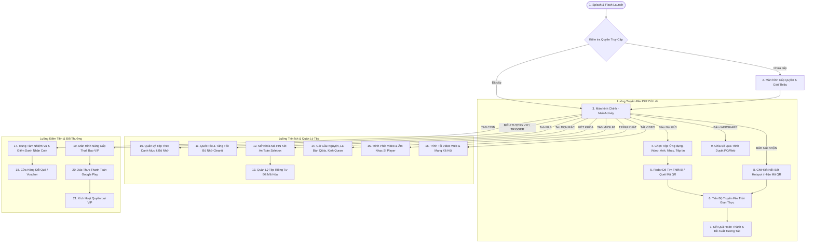

# Báo cáo Cấu Trúc Flow Màn Hình Ứng Dụng & Hành Trình Người Dùng (User Journey)

## 1. Sơ Đồ Cấu Trúc Flow Màn Hình Tổng Thể (Master Screen Flow Diagram)

---

## 2. Đặc Tả Chi Tiết 9 Kịch Bản Hành Trình Người Dùng (User Journeys)

### Hành trình 1: Khởi động Lần đầu & Cấp quyền (Onboarding & Permissions)
* **Luồng tương tác**:
  1. Người dùng mở ứng dụng -> Màn hình `SplashActivity` hiển thị Logo thương hiệu và hoạt họa Lottie khởi động trong 1.5 giây.
  2. Hệ thống kiểm tra quyền lưu trữ và vị trí (cho Wi-Fi Direct). Nếu chưa có -> Điều hướng sang `PermissionRationaleActivity`.
  3. Người dùng bấm *"Tiếp tục"* -> Hệ thống gọi hộp thoại Runtime Permission của Android.
  4. Sau khi người dùng chấp thuận -> Tạo định danh thiết bị `device_uuid` và chuyển thẳng vào `MainActivity`.

---

### Hành trình 2: Gửi File P2P Tốc độ Cao (File Sending Flow)
* **Luồng tương tác**:
  1. Tại `MainActivity`, người dùng bấm nút lớn **"GỬI" (Send)** màu xanh nổi bật.
  2. Chuyển sang `FileSelectActivity`: Giao diện chia thành các Tab ngang (Ứng dụng đã cài, Ảnh chụp, Video, Bài hát, Tài liệu, Tệp nén).
  3. Người dùng tích chọn 5 video và 2 ứng dụng -> Thanh công cụ dưới đáy cập nhật: *"Đã chọn 7 mục (1.2 GB)"*.
  4. Người dùng bấm nút **"GỬI NGAY"** -> Chuyển sang màn hình `RadarDiscoveryActivity`.
  5. Radar hiển thị vòng sóng quét thiết bị xung quanh qua Bluetooth LE và Wi-Fi Broadcast, kèm nút bật Camera để *"Quét mã QR máy nhận"*.
  6. Người dùng chọn Avatar của máy nhận -> Hai máy bắt tay kết nối P2P (Wi-Fi Direct / Local Hotspot).
  7. Chuyển sang `TransferProgressActivity`: Hiển thị thanh tiến trình từng file, tốc độ truyền thời gian thực (ví dụ: `45.8 MB/s`), thời gian ước tính còn lại.
  8. Khi truyền xong 100% -> Chuyển sang `TransferResultActivity` hiển thị thông báo thành công và danh sách file đã gửi.

---

### Hành trình 3: Nhận File P2P (File Receiving Flow)
* **Luồng tương tác**:
  1. Tại `MainActivity`, người dùng bấm nút **"NHẬN" (Receive)**.
  2. Chuyển sang `ReceiveWaitingActivity`: Ứng dụng tự động khởi tạo trạm phát Local Hotspot (LOHS) hoặc mở kênh lắng nghe Wi-Fi Direct.
  3. Màn hình hiển thị một **Mã QR lớn** chứa thông tin SSID, Mật khẩu WPA2 và IP của máy nhận.
  4. Khi máy gửi kết nối vào -> Tự động chấp nhận phiên và chuyển vào màn hình nhận file `TransferProgressActivity`.
  5. File nhận được tự động lưu vào bộ nhớ trong tại đường dẫn: `/storage/emulated/0/Download/SHAREit/`.

---

### Hành trình 4: Chia sẻ File Không Cần Cài App Qua Trình Duyệt PC (WebShare Flow)
* **Luồng tương tác**:
  1. Người dùng chọn tính năng **"WebShare / Kết nối PC"**.
  2. App khởi động WebShare Mini HTTP Server nội bộ trên cổng ngẫu nhiên.
  3. Màn hình hiển thị: *"Hãy mở trình duyệt trên máy tính và nhập: `http://192.168.1.15:8888` hoặc quét mã QR"*.
  4. Máy tính kết nối vào cùng mạng Wi-Fi mở trình duyệt -> Giao diện Web xuất hiện cho phép tải file từ điện thoại về máy tính hoặc kéo thả file từ máy tính lên điện thoại mà không cần dây cáp.

---

### Hành trình 5: Quản lý Tệp & Dọn dẹp Rác (File Manager & Cleanit Flow)
* **Luồng tương tác**:
  1. Người dùng bấm Tab **"Tệp" (Files)** -> Màn hình hiển thị biểu đồ phân tích dung lượng đã dùng / còn trống.
  2. Người dùng bấm nút **"Dọn rác" (Clean)** -> Chuyển sang `CleanitActivity`.
  3. Động cơ quét toàn bộ bộ nhớ đệm (Cache), file thừa APK, file rác tạm và hiển thị: *"Tìm thấy 2.4 GB rác có thể xóa an toàn"*.
  4. Người dùng bấm **"Dọn dẹp ngay"** -> Hiệu ứng dọn rác chạy mượt mà và giải phóng dung lượng bộ nhớ.

---

### Hành trình 6: Két Khóa An Toàn (Safebox Vault Flow)
* **Luồng tương tác**:
  1. Người dùng chọn mục **"Két an toàn" (Safebox)**.
  2. Nhập mã PIN 6 số hoặc quét vân tay -> Mở khóa giao diện `SafeboxVaultActivity`.
  3. Người dùng bấm nút Thêm (+) -> Chọn các ảnh và video nhạy cảm cần ẩn.
  4. Ứng dụng mã hóa file bằng thuật toán **AES-256-GCM** và chuyển vào thư mục riêng tư được bảo vệ.

---

### Hành trình 7: Bộ Tiện Ích Muslim Daily (Muslim Daily Flow)
* **Luồng tương tác**:
  1. Người dùng bấm Tab **"Muslim"**.
  2. Màn hình tự động tính toán và hiển thị chính xác 5 khung giờ cầu nguyện trong ngày (Fajr, Dhuhr, Asr, Maghrib, Isha) theo tọa độ GPS.
  3. Người dùng bấm biểu tượng La bàn -> Chuyển sang màn hình La bàn Qibla điều hướng chính xác hướng về Mecca.
  4. Người dùng có thể đọc Kinh Quran với bản dịch đa ngôn ngữ hoặc đếm hạt tràng Tasbih trên màn hình cảm ứng.

---

### Hành trình 8: Điểm Danh & Tích Lũy Coin (Gamification Flow)
* **Luồng tương tác**:
  1. Người dùng vào Tab **"Điểm thưởng" (Coins)**.
  2. Bấm nút **"Điểm danh ngay"** -> Nhận 100 Coin, chuỗi tăng lên ngày thứ 3.
  3. Danh sách nhiệm vụ hiển thị: *"Truyền 1 file (+50 coin)"*, *"Mời bạn bè (+500 coin)"*.
  4. Khi tích lũy đủ Coin, người dùng vào **"Cửa hàng đổi quà"** để đổi lấy voucher hoặc ngày dùng VIP.

---

### Hành trình 9: Nâng Cấp Thuê Bao VIP Không Quảng Cáo (Paywall Flow)
* **Luồng tương tác**:
  1. Người dùng bấm biểu tượng Vương miện VIP trên thanh Header.
  2. Màn hình Paywall mở ra làm mờ nền phía sau, hiển thị các đặc quyền VIP nổi bật (Tắt sạch quảng cáo, Tốc độ 200MB/s, Két an toàn 200GB).
  3. Mặc định chọn gói *"Năm ($24.99) - Tiết kiệm 50%"*.
  4. Người dùng bấm **"Dùng thử 3 ngày miễn phí & Đăng ký"** -> Google Play Billing BottomSheet bật lên.
  5. Xác nhận vân tay -> Giao dịch hoàn tất, huy hiệu VIP vàng sáng rực và toàn bộ quảng cáo trong ứng dụng biến mất vĩnh viễn.

