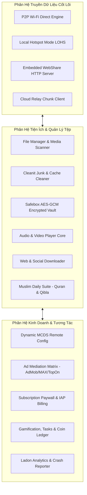

# Báo cáo Phân tích & Tái Cấu Trúc Ứng dụng SHAREit — Tổng Quan Dự Án

## 1. Thông Tin Mẫu Phân Tích

| Thuộc tính | Giá trị chi tiết |
|---|---|
| **Tên gói (Package Name)** | `com.lenovo.anyshare.gps` |
| **Tên ứng dụng** | SHAREit: Transfer, Share Files |
| **Phiên bản (Version)** | 6.53.38_UD (Build VersionCode: `4565338`) |
| **Kích thước file APK** | 74.238.899 bytes (~70.8 MB) |
| **minSdkVersion** | 17 (Android 4.2 Jelly Bean) / Khuyến nghị nâng cấp: 24 (Android 7.0) |
| **targetSdkVersion / compileSdk** | 34 (Android 14) |
| **Application Class** | `aashareit.AnyShareApp` |
| **Số file mã nguồn Java giải mã** | 45.606 files (`SRC/out_src/sources/`) |
| **Số file DEX nhị phân** | 13 file DEX (`classes.dex` đến `classes13.dex`) |
| **Số API Host phát hiện** | 375 host phân tán |
| **Số Thư viện SDK bên thứ ba** | 50+ gói SDK Java/Kotlin + 26 thư viện native (.so) |
| **Cơ chế bảo vệ gốc** | Packer Tierahs (`libTierahs.so`, `libpglarmor.so`, `spg.erahsyna.ovonel.moc.*`), Obfuscation tên ngắn (`a.java`, `p002si.*`) |

---

## 2. Mục Tiêu & Phạm Vi Tái Cấu Trúc Dự Án

Dự án này thực hiện chuyển đổi toàn diện và khôi phục hệ sinh thái ứng dụng theo 3 phần cốt lõi:

```
┌──────────────────────────────────────────────────────────────────────────────────────────────────┐
│                                 DỰ ÁN TÁI CẤU TRÚC HỆ SINH THÁI SHAREIT                           │
├────────────────────────────────┬────────────────────────────────┬────────────────────────────────┤
│    1. ANDROID KOTLIN CLIENT    │   2. BACKEND & CMS (PORT 6030) │     3. BỘ BÁO CÁO CHUYÊN SÂU   │
│       (`Convert/Android`)      │       (`Convert/Backend`)      │       (`Convert/Report`)       │
├────────────────────────────────┼────────────────────────────────┼────────────────────────────────┤
│ • Chuyển đổi 100% sang Kotlin  │ • RESTful API Server Node/TS   │ • 14 tập báo cáo chi tiết      │
│ • Giữ nguyên SDK/Libraries     │ • WebSocket Signaling Engine   │ • 161+ API & Data Models       │
│ • P2P Wi-Fi Direct & Hotspot   │ • Dynamic MCDS Remote Config   │ • Bảng kiểm kê Secrets/Keys    │
│ • WebShare Mini HTTP Server    │ • Waterfall Ad Mediation Server│ • Kịch bản Paywall & Map Mua   │
│ • File Manager & Cleanit Suite │ • Google Play/Apple IAP Billing│ • Flow màn hình & Cây menu     │
│ • Zero-Knowledge Safebox Vault │ • Sổ cái Coin (Idempotent)     │ • 10 Kịch bản Bảo mật/Tấn công │
│ • C++ High-Speed Buffer NDK    │ • Web CMS Admin Dashboard      │ • Blueprint kiến trúc 100%     │
└────────────────────────────────┴────────────────────────────────┴────────────────────────────────┘
```

---

## 3. Kiến Trúc Ứng Dụng Tổng Thể (Functional Architecture)

Ứng dụng SHAREit được định vị là một "Super-Utility App" bao gồm 9 phân hệ chức năng tương hỗ:



---

## 4. Danh Mục Báo Cáo Trong Thư Mục `Report`

| File Báo Cáo | Tên chuyên đề | Nội dung tóm tắt |
|---|---|---|
| `01_TongQuan.md` | Tổng quan Phân tích & Dự án | Thông số kỹ thuật APK, phạm vi và mục tiêu chuyển đổi |
| `02_API_Endpoints_Va_Models.md` | Danh mục 161+ API Endpoints & Models | Bảng API, phương thức, payload, response và khả năng tái dụng |
| `03_DanhSach_SDKs_Libraries.md` | Thống kê SDKs & Native Libraries | Chi tiết 50+ SDK Java, 26 native .so và phiên bản chính xác |
| `04_CauTruc_ThuMuc_Code.md` | Cấu trúc Thư mục Code Android & Backend | Sơ đồ cây và vai trò từng package/module trong dự án |
| `05_BaoMat_Va_KichBan_TanCong.md` | Phân tích Bảo mật & 10 Kịch bản Tấn công | 12 lỗ hổng, ma trận tấn công thực tế và giải pháp triệt tiêu |
| `06_Blueprint_Server_Backend_CMS.md` | Blueprint Kiến trúc Server/Backend/CMS | Bản thiết kế kỹ thuật 100% chuẩn hóa, Database schema, CMS |
| `07_KiemKe_Keys_Secrets_NhayCam.md` | Bảng Kiểm kê Keys, Tokens & Secrets | Toàn bộ khóa API, secret tìm thấy kèm phân loại độ nhạy cảm |
| `08_Paywall_Subscription_MapPurchase.md` | Phân tích Paywall & Bản đồ Mua hàng | Kịch bản gói VIP, trigger paywall, flow Google Play Billing |
| `09_Flow_ManHinh_UserJourney.md` | Luồng Màn hình & User Journey Map | Sơ đồ luồng chuyển trang, tương tác và trạng thái ứng dụng |
| `10_PhanCap_Menu_Tab_ChucNang.md` | Cây Phân cấp Menu, Tab & Tính năng | Cây phả hệ Bottom Bar, Top Tabs, Drawer và Menu ngữ cảnh |
| `11_ChiTiet_ManHinh_NoiDung_UI.md` | Danh mục Chi tiết Màn hình & Giao diện | Danh sách toàn bộ UI screens, thành phần view và logic xử lý |
| `12_DanhMuc_TaiNguyen_CanChuanBi.md` | Danh mục Tài nguyên Cần chuẩn bị | Bảng kê khai Firebase, AdMob, Google Play, Keystore, Domains |
| `13_DanhSach_Domains_IP_Ports.md` | Danh sách External Domains, IPs & Ports | Bảng tra cứu domain, địa chỉ IP, protocol và cổng kết nối |
| `14_DanhGia_TaiDung_SanPhatTuongDuong.md` | Đánh giá Tái dựng & Chiến lược Sản phẩm | Kế hoạch phát triển 1:1, kiểm thử chất lượng và lộ trình QA |

