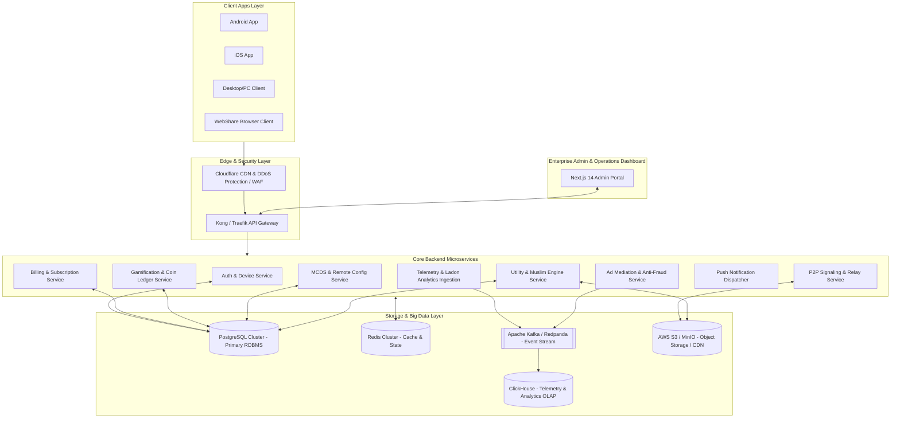
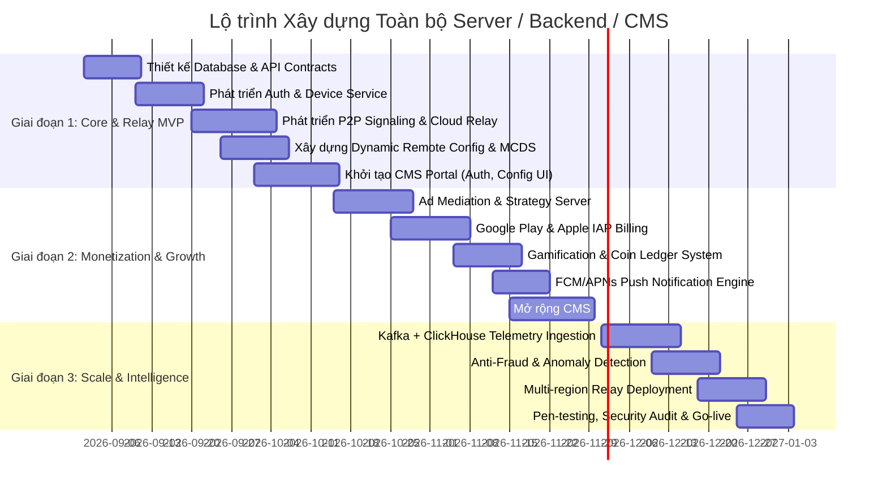

# BÁO CÁO GIẢI PHÁP VÀ THIẾT KẾ HỆ THỐNG SERVER / BACKEND / CMS
## Dự án: Nền tảng Chia sẻ File & Hệ sinh thái Tiện ích Đa Nền tảng (Thay thế hệ thống SHAREit)

---

## 1. Bối cảnh & Khảo sát Hiện trạng Client/API

Qua quá trình decompile mã nguồn APK SHAREit (`com.lenovo.anyshare.gps` v6.53.38_UD), bóc tách 45.606 file Java, phân tích 375 API hosts và cấu trúc RMI Framework, hệ sinh thái client bao gồm 9 phân hệ chức năng cốt lõi cần được server và CMS hỗ trợ:

```
                  ┌─────────────────────────────────────────────────────────┐
                  │                 CLIENT APPLICATION                      │
                  │   (Android / iOS / Desktop / WebShare Browser Client)   │
                  └─────────────────────────┬───────────────────────────────┘
                                            │
         ┌──────────────────────────────────┼─────────────────────────────────┐
         ▼                                  ▼                                 ▼
┌──────────────────┐               ┌──────────────────┐              ┌──────────────────┐
│  Core File P2P   │               │   Auth & User    │              │  Remote Config   │
│ & Relay Sharing  │               │    Management    │              │  & MCDS Content  │
└──────────────────┘               └──────────────────┘              └──────────────────┘
         ▼                                  ▼                                 ▼
┌──────────────────┐               ┌──────────────────┐              ┌──────────────────┐
│   Ad Mediation   │               │  Subscription &  │              │  Gamification &  │
│  & Ad Exchange   │               │   IAP Payments   │              │   Coin Ledger    │
└──────────────────┘               └──────────────────┘              └──────────────────┘
         ▼                                  ▼                                 ▼
┌──────────────────┐               ┌──────────────────┐              ┌──────────────────┐
│  Telemetry & Big │               │ Push Discovery & │              │ Muslim Daily &   │
│  Data Analytics  │               │   Notification   │              │ Utility Services │
└──────────────────┘               └──────────────────┘              └──────────────────┘
```

### Các yêu cầu cải tiến & khắc phục từ phân tích bảo mật:
1. **Chấm dứt hoàn toàn Cleartext HTTP**: Bắt buộc chuẩn hóa 100% kết nối API qua **TLS 1.3 / HTTPS** và cấu hình **Certificate Pinning**.
2. **Loại bỏ việc thu thập dữ liệu nhạy cảm trái phép**: Không sử dụng IMEI, IMSI, MAC Address hay quét danh sách package ứng dụng cài đặt (`QUERY_ALL_PACKAGES`). Thay thế bằng **Device Fingerprinting hợp chuẩn privacy (IDFV/GAID/AppSetID + Server UUID)**.
3. **Cơ chế Ký Tham số An toàn (HMAC-SHA256 Request Signing)**: Thay thế thuật toán ký tĩnh cũ bằng cơ chế Dynamic Nonce + Timestamp Sliding Window (±30s) + HMAC-SHA256 để chống Replay Attack và giả lập request.
4. **Bảo mật Cloud Safebox (Két khóa đám mây)**: Triển khai mô hình **Zero-Knowledge Encryption** (Client-side AES-256-GCM với Master Key do người dùng giữ) trước khi đẩy lên Storage server.

---

## 2. Kiến trúc Tổng thể Hệ thống Backend (System Architecture)

Hệ thống được thiết kế theo mô hình **Cloud-Native Modular Monolith** (cho giai đoạn đầu) và chuyển tiếp mượt mà sang **Microservices** khi quy mô vượt 10M+ MAU, triển khai trên nền Kubernetes (K8s) với khả năng Auto-scaling cao.



### Công nghệ Lựa chọn (Tech Stack)
* **API Gateway**: Kong / Traefik / Envoy (Rate limiting, SSL Termination, JWT Auth Verification, IP Whitelisting).
* **Backend Services**: **Golang (Go 1.23+)** cho các module hiệu năng cao (Signaling, Relay, Ad Mediation, Log Ingestion) + **Node.js (NestJS / TypeScript)** cho Business API & CMS Backend.
* **Primary Database**: **PostgreSQL 16+** (Partitioning, Row-Level Security, JSONB cho dynamic configuration).
* **Caching & Realtime**: **Redis 7 Cluster** (Session, Rate limiting, Leaderboard, Ephemeral P2P Pairing states).
* **Message Broker & Event Stream**: **Apache Kafka / Redpanda** (Xử lý hàng trăm nghìn log events/giây).
* **Big Data / Analytics OLAP**: **ClickHouse** (Lưu trữ và truy vấn siêu tốc telemetry, ad clicks, user funnels).
* **Object Storage**: **AWS S3 / Cloudflare R2 / MinIO Cluster** (CDN assets, Lottie animations, temp relay chunks).
* **P2P Signaling & Relay Core**: **Coturn / WebRTC Pion (Golang)** + Socket.io / Raw TCP WebSocket.

---

## 3. Đặc tả Chi tiết Các Phân hệ Backend (Core Services)

### 3.1. Auth & Device Identity Management Service
* **Mục tiêu**: Thay thế toàn bộ hệ thống định danh `beyla_id` và RMI user provider cũ bằng giải pháp OAuth2.0 / OpenID Connect + Device Fingerprint tuân thủ quy định Google Play / Apple App Store.
* **Cơ chế định danh thiết bị**:
  * Client tạo cặp khóa ECDSA (secp256r1) lưu trong Android Keystore / iOS Keychain.
  * Server cấp phát một `device_uuid` duy nhất khi kích hoạt lần đầu.
  * Mọi request được ký bằng private key của thiết bị (chống giả mạo thiết bị).
* **Phương thức Đăng nhập (Multi-Identity Binding)**:
  * Google Sign-In, Apple ID, Phone OTP (SMS Twilio/Firebase Auth), WeChat/Facebook OAuth.
  * Hỗ trợ Guest Mode (Anonymous User gắn liền với `device_uuid`), cho phép nâng cấp tài khoản không mất dữ liệu.
* **API Endpoints chính**:
  * `POST /api/v1/auth/device/register`: Đăng ký thiết bị mới, nhận token phiên.
  * `POST /api/v1/auth/signin`: Đăng nhập đa nền tảng (OAuth token / OTP).
  * `POST /api/v1/auth/bind`: Liên kết mạng xã hội vào tài khoản hiện tại.
  * `POST /api/v1/auth/token/refresh`: Làm mới Access Token (JWT thời hạn ngắn 15 phút, Refresh Token 30 ngày).
  * `POST /api/v1/auth/user/profile`: Cập nhật thông tin người dùng, avatar.
  * `DELETE /api/v1/auth/user/destroy`: Xóa tài khoản vĩnh viễn (Tuân thủ GDPR/Apple).

---

### 3.2. P2P Signaling & Cloud Relay Transfer Service
* **Mục tiêu**: Thay thế `lenovo.share` và `relay.ushareit.com/relayserver`.
* **Luồng hoạt động (Discovery & Handshake Protocol)**:
  1. **LAN / Wi-Fi Direct Local Mode**: Client tự mở Local HTTP Server hoặc Wi-Fi Direct Hotspot (LOHS). Khi cùng mạng Wi-Fi, sử dụng mDNS / SSDP broadcast để ghép đôi không cần Internet.
  2. **Remote P2P (WebRTC ICE/STUN/TURN)**: Nếu 2 máy ở 2 mạng khác nhau, kết nối vào Signaling Server qua WebSocket để trao đổi SDP Offer/Answer và ICE Candidates.
  3. **Cloud Relay Fallback (Chuyển tiếp đám mây khi NAT traversal thất bại)**:
     * File được chia thành các chunk nhị phân (1MB – 4MB/chunk).
     * Sender đẩy chunk lên Relay Node gần nhất (Edge Relay).
     * Receiver kéo chunk trực tiếp từ Relay Node qua HTTP/3 (QUIC) hoặc WebSocket Binary Stream.
     * Dữ liệu được xóa ngay sau khi truyền hoàn tất (Zero Persistent Retention) để tối ưu chi phí lưu trữ và đảm bảo bảo mật.
* **API Endpoints chính**:
  * `POST /api/v1/relay/session/create`: Khởi tạo phiên chuyển tiếp (sinh Session Code 6 chữ số / QR code).
  * `POST /api/v1/relay/session/join`: Thiết bị nhận tham gia phiên.
  * `POST /api/v1/relay/chunk/upload`: Đẩy luồng dữ liệu chunk.
  * `GET /api/v1/relay/chunk/download`: Kéo luồng dữ liệu chunk kèm cơ chế Resume (HTTP Range).
  * `WS /api/v1/signaling/webrtc`: Kênh WebSocket trao đổi SDP/ICE candidates.

---

### 3.3. Dynamic Remote Config & MCDS Engine (Marketing & Content Delivery)
* **Mục tiêu**: Thay thế hệ thống MCDS (`com.ushareit.mcds`) và CCM remote configuration.
* **Tính năng**:
  * Quản lý động các `spaceId` (vị trí hiển thị trên App: Home Banner, Transfer Complete Interstitial, Drawer, Tools Tab).
  * Quản lý `promUnitConfig`: Tần suất hiển thị (Frequency Capping), số lần hiển thị tối đa (`showTimes`), thời gian giãn cách (`intervalSec`).
  * Bộ lọc điều kiện linh hoạt (`ruleEngine`): Phiên bản app (`versionCode`), Quốc gia (`country`), Loại mạng (`WiFi/5G`), Hành vi người dùng (`pageBehaviorCond`).
  * Cấu hình Lottie Animation, Icon, Banner, DeepLink điều hướng nội bộ hoặc mở URL ngoài.
  * **Chữ ký số Server (Server-Signed Payload)**: Toàn bộ JSON config được server ký bằng RSA-256 / Ed25519; Client xác minh chữ ký trước khi áp dụng để chống tấn công giả mạo cấu hình.
* **API Endpoints chính**:
  * `POST /api/v1/mcds/fetch`: Lấy danh sách cấu hình, banner, không gian hiển thị được cá nhân hóa theo thiết bị.
  * `POST /api/v1/config/app/init`: Cấu hình khởi động toàn cục (Feature Flags, Kill-switch, Maintenance mode, Base URL fallback).
  * `POST /api/v1/upgrade/check`: Kiểm tra phiên bản cập nhật ứng dụng (Force update / Soft update / Diff patch URL).

---

### 3.4. Ad Mediation & Anti-Fraud Tracking Server (Midas Replacement)
* **Mục tiêu**: Thay thế ad-exchange nội bộ `com.adexchange` (Midas / ShareMob / Beyla / Plutus).
* **Tính năng**:
  * **Waterfall & Dynamic Mediation**: Trả về danh sách mạng quảng cáo tối ưu cho từng Ad Placement (AdMob, AppLovin MAX, ironSource, Mintegral, Unity Ads, Pangle) dựa theo eCPM dự đoán và quốc gia.
  * **A/B Testing Ad Units**: Thử nghiệm tỷ lệ phân bổ mạng quảng cáo.
  * **Attribution & Conversion Tracking**: Ghi nhận Impression, Click, CPI/CPA qua endpoint bảo mật.
  * **Anti-Fraud & Click Spam Prevention**: Kiểm tra chữ ký request, IP blacklist, phát hiện click ảo, chặn bot farm quảng cáo.
* **API Endpoints chính**:
  * `POST /api/v1/ads/strategy/get`: Lấy ma trận cấu hình vị trí quảng cáo theo thiết bị & quốc gia.
  * `POST /api/v1/ads/track/impression`: Ghi nhận lượt hiển thị hợp lệ.
  * `POST /api/v1/ads/track/click`: Ghi nhận lượt click & redirect tracking.
  * `POST /api/v1/ads/attribution/cpi`: Ghi nhận cài đặt ứng dụng từ đối tác (Server-to-Server Postback).

---

### 3.5. Subscription & Payment Gateway Service
* **Mục tiêu**: Xử lý logic mua hàng IAP, loại bỏ quảng cáo, nâng cấp gói VIP (thay thế `com.ushareit.subscription`).
* **Tính năng**:
  * Tích hợp **Google Play Billing Developer API v3 (Google Play Developer Notifications via Google Cloud Pub/Sub)**.
  * Tích hợp **Apple StoreKit 2 (App Store Server Notifications V2)**.
  * Tích hợp cổng thanh toán Web/PC: Stripe, PayPal, MoMo, VNPay (qua Web checkout).
  * Đồng bộ quyền hạn (Entitlements) theo thời gian thực: Tự động gia hạn (Auto-Renew), Grace Period, Cancel, Refund.
* **API Endpoints chính**:
  * `POST /api/v1/pay/order/create`: Tạo yêu cầu đơn hàng thanh toán.
  * `POST /api/v1/pay/order/verify`: Xác thực biên lai thanh toán (Purchase Token) với Google Play / Apple Server.
  * `GET /api/v1/pay/subscription/status`: Kiểm tra trạng thái VIP của người dùng hiện tại.
  * `POST /api/v1/pay/webhook/google`: Webhook nhận sự kiện tự động từ Google Cloud Pub/Sub.
  * `POST /api/v1/pay/webhook/apple`: Webhook nhận sự kiện từ Apple StoreKit.

---

### 3.6. Gamification, Tasks & Coin Reward Ledger Service
* **Mục tiêu**: Tái cấu trúc phân hệ điểm thưởng / coin (`com.ushareit.coin`).
* **Tính năng**:
  * Điểm danh hàng ngày (Daily Check-in Streak).
  * Nhiệm vụ tương tác: Truyền file đủ dung lượng, xem video ngắn, mời bạn bè (Invite Code Referral).
  * **Sổ cái Coin (Idempotent Ledger Engine)**: Mọi giao dịch cộng/trừ coin đều có `transaction_id`, đảm bảo không cộng đúp khi mạng chập chờn.
  * Hệ thống Đổi thưởng (Redeem Store): Đổi coin lấy dung lượng lưu trữ, voucher hoặc VIP pass.
* **API Endpoints chính**:
  * `GET /api/v1/coin/balance`: Lấy số dư coin và lịch sử biến động.
  * `POST /api/v1/coin/task/list`: Lấy danh sách nhiệm vụ hiện có.
  * `POST /api/v1/coin/task/claim`: Nhận thưởng sau khi hoàn thành nhiệm vụ.
  * `POST /api/v1/coin/checkin`: Điểm danh nhận quà theo chuỗi ngày.
  * `POST /api/v1/coin/redeem`: Quy đổi quà tặng từ kho voucher.

---

### 3.7. Telemetry, Analytics & Crash Logging Service (Ladon & ULog Replacement)
* **Mục tiêu**: Thay thế hệ thống thu thập analytics `ladon.dalyfeds.com` và log Meituan Logan.
* **Tính năng**:
  * Thu thập sự kiện phân tích người dùng theo batch (Batch Size: 50 events hoặc mỗi 30 giây).
  * Ghi nhận phễu truyền file (Transfer Speed, File Type, Success Rate, Fail Reasons).
  * Nhận báo cáo Crash (Native Crash, ANR, Exception) có mã hóa.
  * Gửi dữ liệu vào Kafka Broker -> Đưa vào ClickHouse để truy vấn real-time trên Dashboard.
* **API Endpoints chính**:
  * `POST /api/v1/telemetry/events/batch`: Gửi lô sự kiện analytics từ app.
  * `POST /api/v1/telemetry/crash/report`: Gửi stack trace sự cố kèm thông số máy.
  * `POST /api/v1/feedback/submit`: Gửi phản hồi người dùng, kèm file ảnh chụp màn hình.

---

### 3.8. Push Notification & Real-time Dispatcher Engine
* **Mục tiêu**: Quản lý thông báo đẩy thông minh thay thế hệ thống đa kênh (`com.heytap`, `vivo`, `xiaomi`, `huawei`, `firebase`).
* **Tính năng**:
  * Tích hợp Firebase Cloud Messaging (FCM HTTP v1 API) chuẩn hóa.
  * Tích hợp Apple Push Notification Service (APNs HTTP/2).
  * Cơ chế định thời theo múi giờ địa phương của người dùng (Smart Timezone Delivery).
  * Phân đoạn đối tượng (Segmentation): Gửi theo quốc gia, phiên bản app, người dùng không hoạt động > 7 ngày.

---

## 4. Thiết kế Hệ thống CMS Quản trị Toàn diện (Admin Portal)

CMS được thiết kế dành cho Đội ngũ Vận hành, Marketing, Quản trị viên và Kỹ thuật viên (Tech/DevOps).

```
┌─────────────────────────────────────────────────────────────────────────────────────────────┐
│                               ENTERPRISE CMS ADMIN PORTAL                                   │
├──────────────┬──────────────────────────────────────────────────────────────────────────────┤
│ 📊 Dashboard │  • Real-time Active Devices: 124,500   • Relay Traffic Today: 4.2 TB         │
│              │  • Ad Revenue Today: $3,450.20          • New Subscriptions: +284             │
├──────────────┼──────────────────────────────────────────────────────────────────────────────┤
│ 📱 Devices   │  • Quản lý Thiết bị: Device UUID, Platform, GAID, Country, Status (Active/Banned)│
│ & Users      │  • Quản lý Tài khoản, Lịch sử đăng nhập, Phiên hoạt động, Xóa/Khóa tài khoản │
├──────────────┼──────────────────────────────────────────────────────────────────────────────┤
│ 🎨 MCDS &    │  • Visual Slot Builder: Kéo thả Banner, Lottie Animation, Icon vào Space ID  │
│ Config       │  • Rule Engine: Cấu hình phân phối theo Quốc gia, Version, Tần suất hiển thị │
│              │  • A/B Testing & Phê duyệt cấu hình: Ký số tự động khi Publish Release        │
├──────────────┼──────────────────────────────────────────────────────────────────────────────┤
│ 💰 Ad Matrix │  • Quản lý Ma trận Ad Placements: Splash, Interstitial, Native, Banner       │
│ Management   │  • Điều hướng Waterfall: Đặt eCPM sàn cho từng quốc gia & Ad Network         │
│              │  • Báo cáo Real-time Fill-rate, Show-rate, CTR, eCPM, Cảnh báo Click Ảo      │
├──────────────┼──────────────────────────────────────────────────────────────────────────────┤
│ 💎 Sub & IAP │  • Quản lý Gói cước (Weekly, Monthly, Yearly, Lifetime)                      │
│ Management   │  • Báo cáo Doanh thu MRR, Churn Rate, Lịch sử Giao dịch & Hoàn tiền          │
├──────────────┼──────────────────────────────────────────────────────────────────────────────┤
│ 🎁 Coins &   │  • Thiết lập Danh mục Nhiệm vụ (Task), Hệ số thưởng Điểm danh                │
│ Gamification │  • Quản lý Kho Quà tặng & Voucher, Giám sát và Chặn User Farm Coin           │
├──────────────┼──────────────────────────────────────────────────────────────────────────────┤
│ 🔔 Push &    │  • Soạn thảo Chiến dịch Push Notification đa ngôn ngữ                        │
│ Campaigns    │  • Lên lịch gửi theo Múi giờ, Deep link vào tính năng app                    │
├──────────────┼──────────────────────────────────────────────────────────────────────────────┤
│ 🛡️ Security  │  • WAF & Rate Limiting Monitor: Cảnh báo IP nghi vấn, DDoS                   │
│ & Audit Log  │  • Nhật ký thao tác Admin (Audit Logs), Quản lý Phân quyền nhân viên (RBAC)  │
└──────────────┴──────────────────────────────────────────────────────────────────────────────┘
```

### Công nghệ đề xuất cho CMS:
* **Frontend**: Next.js 14 (App Router), React 18, TypeScript, TailwindCSS, Shadcn UI, TanStack Table v8, Tremor / Recharts (Biểu đồ).
* **Quản lý Quyền (RBAC)**: Casbin / Permission matrix (Super Admin, Marketing Ops, Ad Monetization Manager, Customer Support, Auditor).
* **Xác thực CMS**: Two-Factor Authentication (2FA TOTP), SSO (Google Workspace SAML/OAuth).

---

## 5. Thiết kế Cơ sở Dữ liệu & Schema Models

### 5.1. Mô hình Quan hệ (PostgreSQL Database Schema)

```sql
-- 1. Bảng Thiết bị (Device Fingerprint)
CREATE TABLE devices (
    id UUID PRIMARY KEY DEFAULT gen_random_uuid(),
    device_uuid VARCHAR(64) UNIQUE NOT NULL,
    public_key TEXT,
    os_type VARCHAR(16) NOT NULL, -- 'android', 'ios', 'windows', 'macos'
    os_version INT NOT NULL,
    app_version VARCHAR(32) NOT NULL,
    app_version_code INT NOT NULL,
    device_model VARCHAR(64),
    manufacturer VARCHAR(64),
    language VARCHAR(16) DEFAULT 'en',
    country_code VARCHAR(8) DEFAULT 'VN',
    gaid_idfv VARCHAR(64),
    fcm_token TEXT,
    is_banned BOOLEAN DEFAULT FALSE,
    first_seen_at TIMESTAMPTZ DEFAULT NOW(),
    last_active_at TIMESTAMPTZ DEFAULT NOW()
);

-- 2. Bảng Người dùng (Users)
CREATE TABLE users (
    id UUID PRIMARY KEY DEFAULT gen_random_uuid(),
    display_name VARCHAR(100),
    avatar_url TEXT,
    email VARCHAR(255) UNIQUE,
    phone VARCHAR(32) UNIQUE,
    is_vip BOOLEAN DEFAULT FALSE,
    vip_expire_at TIMESTAMPTZ,
    coin_balance BIGINT DEFAULT 0,
    status VARCHAR(16) DEFAULT 'active', -- 'active', 'suspended', 'deleted'
    created_at TIMESTAMPTZ DEFAULT NOW(),
    updated_at TIMESTAMPTZ DEFAULT NOW()
);

-- 3. Bảng Liên kết Thiết bị & Người dùng (Device Sessions)
CREATE TABLE user_devices (
    id UUID PRIMARY KEY DEFAULT gen_random_uuid(),
    user_id UUID REFERENCES users(id) ON DELETE CASCADE,
    device_id UUID REFERENCES devices(id) ON DELETE CASCADE,
    access_token_hash VARCHAR(64),
    refresh_token_hash VARCHAR(64),
    expires_at TIMESTAMPTZ NOT NULL,
    created_at TIMESTAMPTZ DEFAULT NOW(),
    UNIQUE(user_id, device_id)
);

-- 4. Bảng Cấu hình MCDS & Dynamic Spaces
CREATE TABLE mcds_spaces (
    id UUID PRIMARY KEY DEFAULT gen_random_uuid(),
    space_id VARCHAR(64) UNIQUE NOT NULL, -- 'home_top_banner', 'transfer_interstitial'
    name VARCHAR(128) NOT NULL,
    description TEXT,
    is_active BOOLEAN DEFAULT TRUE,
    priority INT DEFAULT 0,
    created_at TIMESTAMPTZ DEFAULT NOW()
);

CREATE TABLE mcds_promotes (
    id UUID PRIMARY KEY DEFAULT gen_random_uuid(),
    space_id VARCHAR(64) REFERENCES mcds_spaces(space_id) ON DELETE CASCADE,
    title VARCHAR(255),
    content_type VARCHAR(32) NOT NULL, -- 'image', 'lottie', 'h5', 'native_ad'
    media_url TEXT NOT NULL,
    action_type VARCHAR(32) NOT NULL, -- 'deeplink', 'external_url', 'open_tab'
    action_value TEXT NOT NULL,
    targeting_rules JSONB, -- {"countries": ["VN", "ID"], "min_version": 100}
    frequency_capping JSONB, -- {"max_impressions_per_day": 3, "interval_sec": 3600}
    priority INT DEFAULT 1,
    start_time TIMESTAMPTZ,
    end_time TIMESTAMPTZ,
    is_active BOOLEAN DEFAULT TRUE,
    created_at TIMESTAMPTZ DEFAULT NOW()
);

-- 5. Bảng Cấu hình Quảng cáo (Ad Placements & Mediation Matrix)
CREATE TABLE ad_placements (
    id UUID PRIMARY KEY DEFAULT gen_random_uuid(),
    placement_id VARCHAR(64) UNIQUE NOT NULL, -- 'trans_complete_interstitial'
    placement_type VARCHAR(32) NOT NULL, -- 'banner', 'interstitial', 'rewarded', 'native'
    mediation_waterfall JSONB NOT NULL, -- [{"network": "admob", "unit_id": "ca-app-pub...", "ecpm_floor": 2.5}, ...]
    country_overrides JSONB,
    is_active BOOLEAN DEFAULT TRUE,
    updated_at TIMESTAMPTZ DEFAULT NOW()
);

-- 6. Bảng Quản lý Gói & Giao dịch IAP (Subscriptions & Orders)
CREATE TABLE subscription_plans (
    id VARCHAR(64) PRIMARY KEY, -- 'vip_monthly', 'vip_yearly'
    title VARCHAR(128) NOT NULL,
    price DECIMAL(10, 2) NOT NULL,
    currency VARCHAR(8) DEFAULT 'USD',
    duration_days INT NOT NULL,
    google_product_id VARCHAR(128),
    apple_product_id VARCHAR(128),
    is_active BOOLEAN DEFAULT TRUE
);

CREATE TABLE payment_orders (
    id UUID PRIMARY KEY DEFAULT gen_random_uuid(),
    order_code VARCHAR(64) UNIQUE NOT NULL,
    user_id UUID REFERENCES users(id),
    device_id UUID REFERENCES devices(id),
    plan_id VARCHAR(64) REFERENCES subscription_plans(id),
    gateway VARCHAR(32) NOT NULL, -- 'google_play', 'apple_iap', 'stripe'
    transaction_id VARCHAR(128),
    purchase_token TEXT,
    amount DECIMAL(10, 2) NOT NULL,
    currency VARCHAR(8) DEFAULT 'USD',
    status VARCHAR(32) DEFAULT 'pending', -- 'pending', 'paid', 'failed', 'refunded'
    raw_response JSONB,
    created_at TIMESTAMPTZ DEFAULT NOW(),
    updated_at TIMESTAMPTZ DEFAULT NOW()
);

-- 7. Bảng Sổ cái Điểm thưởng Coin (Idempotent Coin Ledger)
CREATE TABLE coin_ledger (
    id UUID PRIMARY KEY DEFAULT gen_random_uuid(),
    transaction_id VARCHAR(64) UNIQUE NOT NULL,
    user_id UUID REFERENCES users(id) ON DELETE CASCADE,
    event_type VARCHAR(32) NOT NULL, -- 'daily_checkin', 'share_file', 'invite_friend', 'redeem'
    amount BIGINT NOT NULL, -- Dương: cộng coin, Âm: trừ coin
    balance_after BIGINT NOT NULL,
    metadata JSONB,
    created_at TIMESTAMPTZ DEFAULT NOW()
);

-- 8. Bảng Quản trị & Phân quyền CMS (Admin RBAC & Audit Log)
CREATE TABLE admin_users (
    id UUID PRIMARY KEY DEFAULT gen_random_uuid(),
    username VARCHAR(64) UNIQUE NOT NULL,
    email VARCHAR(128) UNIQUE NOT NULL,
    password_hash VARCHAR(255) NOT NULL,
    role VARCHAR(32) NOT NULL, -- 'super_admin', 'marketing', 'support', 'auditor'
    two_factor_secret VARCHAR(64),
    is_active BOOLEAN DEFAULT TRUE,
    created_at TIMESTAMPTZ DEFAULT NOW()
);

CREATE TABLE admin_audit_logs (
    id UUID PRIMARY KEY DEFAULT gen_random_uuid(),
    admin_id UUID REFERENCES admin_users(id),
    action VARCHAR(64) NOT NULL,
    resource VARCHAR(64) NOT NULL,
    resource_id VARCHAR(64),
    old_data JSONB,
    new_data JSONB,
    ip_address VARCHAR(45),
    user_agent TEXT,
    created_at TIMESTAMPTZ DEFAULT NOW()
);
```

### 5.2. Mô hình Dữ liệu Lớn & Phân tích (ClickHouse OLAP Schema)

```sql
-- 1. Bảng Sự kiện Telemetry Phân tích
CREATE TABLE default.telemetry_events (
    event_time DateTime64(3, 'UTC'),
    event_name LowCardinality(String),
    device_uuid String,
    user_id String,
    app_version LowCardinality(String),
    os_type LowCardinality(String),
    country_code LowCardinality(String),
    session_id String,
    properties String -- JSON Object
) ENGINE = MergeTree()
PARTITION BY toYYYYMM(event_time)
ORDER BY (event_name, country_code, event_time);

-- 2. Bảng Phân tích Hiệu suất Truyền File (Relay & P2P)
CREATE TABLE default.file_transfer_logs (
    transfer_time DateTime64(3, 'UTC'),
    session_id String,
    transfer_mode LowCardinality(String), -- 'wifi_direct', 'lan', 'cloud_relay'
    sender_device String,
    receiver_device String,
    file_size_bytes UInt64,
    transfer_duration_ms UInt32,
    speed_mbps Float32,
    status LowCardinality(String), -- 'success', 'failed', 'canceled'
    error_code String
) ENGINE = MergeTree()
PARTITION BY toYYYYMM(transfer_time)
ORDER BY (transfer_mode, status, transfer_time);

-- 3. Bảng Ghi nhận Hiển thị & Click Quảng cáo
CREATE TABLE default.ad_events (
    event_time DateTime64(3, 'UTC'),
    placement_id LowCardinality(String),
    ad_network LowCardinality(String),
    event_type LowCardinality(String), -- 'request', 'filled', 'impression', 'click'
    device_uuid String,
    country_code LowCardinality(String),
    ecpm Float32,
    revenue Float64
) ENGINE = MergeTree()
PARTITION BY toYYYYMM(event_time)
ORDER BY (placement_id, ad_network, event_time);
```

---

## 6. Chiến lược Bảo mật & Mã hóa (Security & Hardening)

```
┌─────────────────────────────────────────────────────────────────────────────────────────────┐
│                             SECURITY HARDENING PIPELINE                                     │
├──────────────────────────┬──────────────────────────────────────────────────────────────────┤
│ 1. Request Signing       │ • HMAC-SHA256(Method + Path + Timestamp + Nonce + Body, Secret)  │
│    (Chống sửa & replay)  │ • Header: X-App-Timestamp, X-App-Nonce, X-App-Signature         │
│                          │ • Server xác thực timestamp trong cửa sổ ±30 giây; lưu Nonce 60s │
├──────────────────────────┼──────────────────────────────────────────────────────────────────┤
│ 2. TLS & Pinning         │ • Bắt buộc TLS 1.3 với Forward Secrecy (ECDHE-RSA/ECDSA)         │
│                          │ • Public Key Pinning (HPKP) trong mã nguồn Client                │
├──────────────────────────┼──────────────────────────────────────────────────────────────────┤
│ 3. Zero-Knowledge Safebox│ • File trong Két khóa được mã hóa AES-GCM-256 trên Client        │
│                          │ • Master Key phái sinh từ Password + PBKDF2 (100.000 rounds)     │
│                          │ • Server chỉ lưu Blob mã hóa; Server không thể giải mã nội dung │
├──────────────────────────┼──────────────────────────────────────────────────────────────────┤
│ 4. Rate Limiting & WAF   │ • Token Bucket Rate Limiting: 60 req/phút/IP đối với API thông thường│
│                          │ • 5 req/phút đối với API Auth & Thanh toán                      │
│                          │ • Cloudflare Bot Management chặn tự động các công cụ cào dữ liệu │
└──────────────────────────┴──────────────────────────────────────────────────────────────────┘
```

---

## 7. Kế hoạch Triển khai Hạ tầng (DevOps & Scaling Blueprint)

### 7.1. Cấu trúc Mạng & Multi-Region Nodes
* **Central Control Plane (Singapore)**: Đặt cụm Kubernetes chính quản lý Auth, MCDS, CMS, PostgreSQL, Kafka, ClickHouse.
* **Edge Relay Nodes (Singapore, Tokyo, Frankfurt, San Francisco)**:
  * Cụm Relay Server siêu nhẹ (Golang + WebSocket/QUIC) phục vụ trung chuyển dữ liệu P2P.
  * Tự động điều hướng thiết bị tới Relay Node có độ trễ (latency) thấp nhất thông qua GeoDNS / Anycast IP.

### 7.2. Cấu hình Mẫu Kubernetes Deployment (Core API Service)

```yaml
apiVersion: apps/v1
kind: Deployment
metadata:
  name: shareit-core-api
  namespace: production
spec:
  replicas: 5
  selector:
    matchLabels:
      app: shareit-core-api
  template:
    metadata:
      labels:
        app: shareit-core-api
    spec:
      containers:
      - name: api
        image: registry.internal/shareit/core-api:v1.0.0
        resources:
          requests:
            cpu: "500m"
            memory: "512Mi"
          limits:
            cpu: "2000m"
            memory: "2048Mi"
        ports:
        - containerPort: 8080
        readinessProbe:
          httpGet:
            path: /healthz
            port: 8080
          initialDelaySeconds: 5
          periodSeconds: 10
        livenessProbe:
          httpGet:
            path: /healthz
            port: 8080
          initialDelaySeconds: 15
          periodSeconds: 20
```

---

## 8. Lộ trình Triển khai (Phased Implementation Roadmap)



### Chi tiết các mốc (Milestones):
1. **Giai đoạn 1 (4 - 5 tuần) — Core Infrastructure & P2P Engine**:
   * Triển khai Database PostgreSQL, Redis.
   * Xây dựng Core API Gateway, Auth/Device Service, P2P Signaling & Relay Server.
   * Xây dựng MCDS Remote Config Engine + CMS cơ bản để quản lý cấu hình từ xa.
2. **Giai đoạn 2 (4 - 5 tuần) — Kiếm tiền & Tăng trưởng (Monetization)**:
   * Tích hợp Ad Mediation Matrix (AdMob, AppLovin, Mintegral waterfall).
   * Tích hợp IAP Billing (Google Play / Apple StoreKit) + Webhooks tự động.
   * Triển khai Coin Ledger, Daily Check-in & Push Notification Dispatcher.
   * Hoàn thiện CMS phân hệ Quảng cáo, Giao dịch, Quà tặng và Chiến dịch Push.
3. **Giai đoạn 3 (3 - 4 tuần) — Tối ưu hóa Dữ liệu Lớn & Bảo mật**:
   * Tích hợp ClickHouse Telemetry & phân tích chuyên sâu hiệu suất truyền file.
   * Cài đặt WAF, Rate limiting, HMAC Request Signing, Anti-fraud.
   * Mở rộng mạng lưới Relay Nodes đa vùng (Singapore, US, EU).
   * Kiểm thử tải (Load Testing 100.000 concurrent sessions) và Đánh giá An toàn Thông tin trước khi phát hành.

---
*Báo cáo được khởi tạo tự động dựa trên kết quả giải mã và phân tích chuyên sâu toàn bộ mã nguồn ứng dụng SHAREit.*
