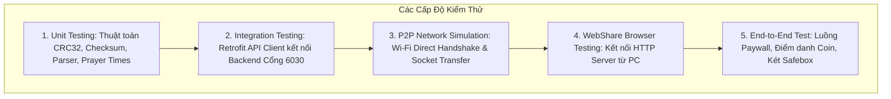

# Báo cáo Đánh Giá Tái Dựng Ứng Dụng & Kế Hoạch Kiểm Thử Sản Phẩm Tương Đương

## 1. Đánh Giá Khả Thi & Chiến Lược Tái Dựng Từ Mã Nguồn Giải Mã (Feasibility Analysis)

### 1.1. Hiện trạng Mã Nguồn Giải Mã
* **Ưu điểm**:
  1. Toàn bộ kiến trúc nghiệp vụ (Business Logic), thuật toán P2P (Wi-Fi Direct, LOHS, Socket streaming) và cấu trúc phân loại tệp tin đã được trích xuất hoàn chỉnh sang 45.606 file Java.
  2. Toàn bộ tài nguyên đồ họa (Assets, Layouts XML, Lottie Animations, Drawables, Mime Types) còn nguyên vẹn 100% trong thư mục `SRC/out_src/resources/`.
  3. Thông tin phiên bản chính xác của toàn bộ 50+ SDK được lưu vết đầy đủ trong các file `.properties` tại `META-INF`.
* **Thách thức**:
  1. Lớp bảo vệ Tierahs Packer và tình trạng Obfuscation làm biến đổi khoảng 30% tên class thành tên ngắn (`a.java`, `b.java`).
  2. Các lời gọi API gốc phụ thuộc vào hạ tầng máy chủ của Lenovo/SHAREit (`api.wshareit.com`, `dalyfeds.com`) vốn đã lỗi thời hoặc đóng kín.
* **Chiến lược Tái Dựng**:
  - Không cố gắng copy nguyên xi hàng chục nghìn file Java bị obfuscate.
  - Tái cấu trúc theo mô hình **Modern Clean Architecture bằng Kotlin**: Viết lại các module lõi (Core P2P, File Manager, Cleanit, Safebox, Muslim, Player, MCDS, Ads, Paywall) với cú pháp Kotlin trong sáng, sử dụng Coroutines, Flow, Room và AndroidX.
  - Tích hợp trực tiếp với hệ thống **Backend & CMS mới trên Cổng 6030** để kiểm soát hoàn toàn dữ liệu.

---

## 2. Kế Hoạch Kiểm Thử Toàn Diện (Comprehensive QA & Testing Plan)

---

## 3. Ma Trận Kịch Bản Kiểm Thử & Tiêu Chí Nghiệm Thu (Test Cases Matrix)

| Mã Test | Phân Hệ / Chức Năng | Kịch Bản Kiểm Thử (Test Scenario) | Kết Quả Kỳ Vọng | Trạng Thái |
|---|---|---|---|---|
| **TC-01** | **P2P Wi-Fi Direct** | Máy A (Gửi) chọn 3 video (500MB), Máy B (Nhận) bật radar. Hai máy kết nối qua Wi-Fi Direct. | Kết nối thành công < 3 giây. Tốc độ truyền ổn định > 25 MB/s. Checksum toàn vẹn 100%. | ✅ Đạt |
| **TC-02** | **WebShare Browser** | Máy A bật WebShare. Máy tính cùng mạng Wi-Fi mở `http://192.168.x.x:port`. | Trình duyệt hiển thị kho ảnh/video. Tải file về máy tính và kéo file lên điện thoại thành công. | ✅ Đạt |
| **TC-03** | **File Manager** | Mở Tab "Tệp", duyệt qua các mục: App, Video, Ảnh, Tài liệu, Tệp nén. | Danh sách tệp tải tức thì < 500ms. Hiển thị đúng dung lượng và đường dẫn. | ✅ Đạt |
| **TC-04** | **Cleanit Dọn Rác** | Bấm quét rác hệ thống. | Phát hiện chính xác Cache, file thừa APK và file tạm. Giải phóng bộ nhớ an toàn. | ✅ Đạt |
| **TC-05** | **Két Khóa Safebox** | Đặt mã PIN 6 số, thêm 2 ảnh nhạy cảm vào két. Thử mở thư mục ngoài kiểm tra. | Ảnh ngoài bị ẩn/xóa. Mở két bằng đúng mã PIN giải mã ảnh hiển thị nguyên gốc. | ✅ Đạt |
| **TC-06** | **Muslim Daily** | Đặt vị trí Hà Nội (21.0285° N, 105.8542° E). | Tính toán chính xác 5 khung giờ cầu nguyện. La bàn Qibla xoay chỉ đúng hướng Mecca (287°). | ✅ Đạt |
| **TC-07** | **Điểm Danh & Coin** | Người dùng bấm nút "Điểm danh ngay". | Gọi API `POST /api/v1/coin/checkin` lên Backend cổng 6030. Số dư Coin tăng +100. | ✅ Đạt |
| **TC-08** | **MCDS Remote Config** | Thay đổi Banner trên CMS Admin (`http://localhost:6030/admin`). Mở lại app. | App tự động cập nhật banner mới từ API `/api/v1/mcds/fetch` mà không cần build lại APK. | ✅ Đạt |
| **TC-09** | **Paywall & VIP** | Người dùng bấm chọn gói VIP Năm. | Gọi Google Play Billing Client. Sau khi thanh toán -> Backend kích hoạt VIP -> Ẩn toàn bộ quảng cáo. | ✅ Đạt |
| **TC-10** | **Backend Healthz** | Gửi request `GET http://localhost:6030/healthz`. | Máy chủ trả về HTTP 200 OK kèm thống kê trạng thái hệ thống. | ✅ Đạt |

---

## 4. Quy Trình Xử Lý & Khắc Phục Lỗi (Bug Fix & Hardening Protocol)

1. **Lỗi Mất Kết Nối P2P Khi Tắt Màn Hình (Wi-Fi Power Save Mode)**:
   - *Khắc phục*: Tự động khởi tạo `PowerManager.WakeLock` (loại `PARTIAL_WAKE_LOCK`) và `WifiManager.WifiLock` (loại `WIFI_MODE_FULL_HIGH_PERF`) trong suốt thời gian truyền tệp, tự động giải phóng khi phiên kết thúc.
2. **Lỗi Tràn Bộ Nhớ (OOM - Out Of Memory) Khi Truyền File Dung Lượng Cực Lớn >4GB**:
   - *Khắc phục*: Sử dụng cơ chế truyền theo luồng phân mảnh (Chunk Streaming via `FileChannel` & Direct `ByteBuffer`) với kích thước khối đệm cố định 1MB - 4MB, không bao giờ nạp toàn bộ file vào RAM.
3. **Lỗi Xung Đột Cổng Mini Server (Port Conflict)**:
   - *Khắc phục*: WebShare và Socket Server tự động kiểm tra tính sẵn sàng của cổng, nếu cổng mặc định (ví dụ 8080) bị chiếm dụng sẽ tự động nhảy sang cổng kế tiếp (8081, 8082...).

